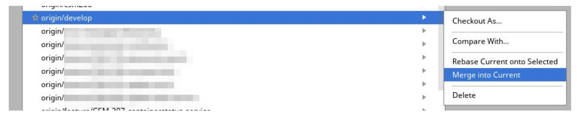
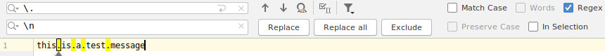
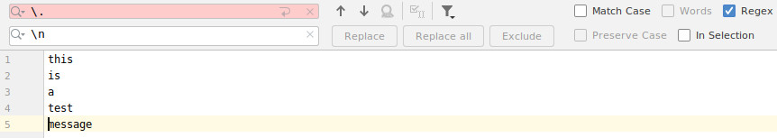
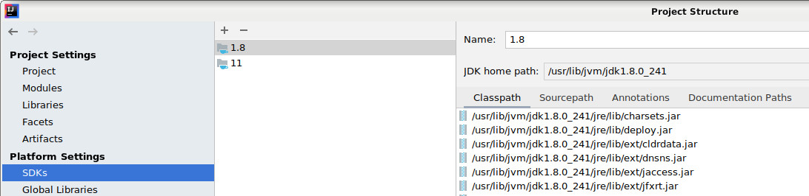
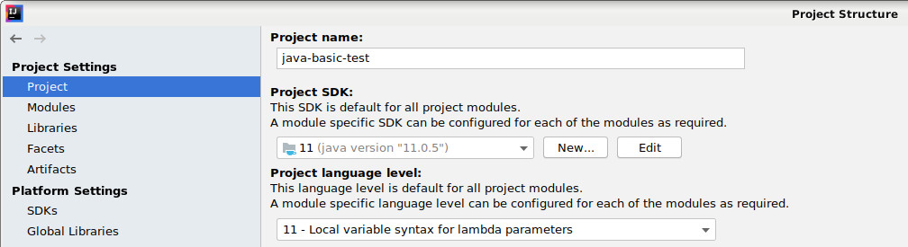
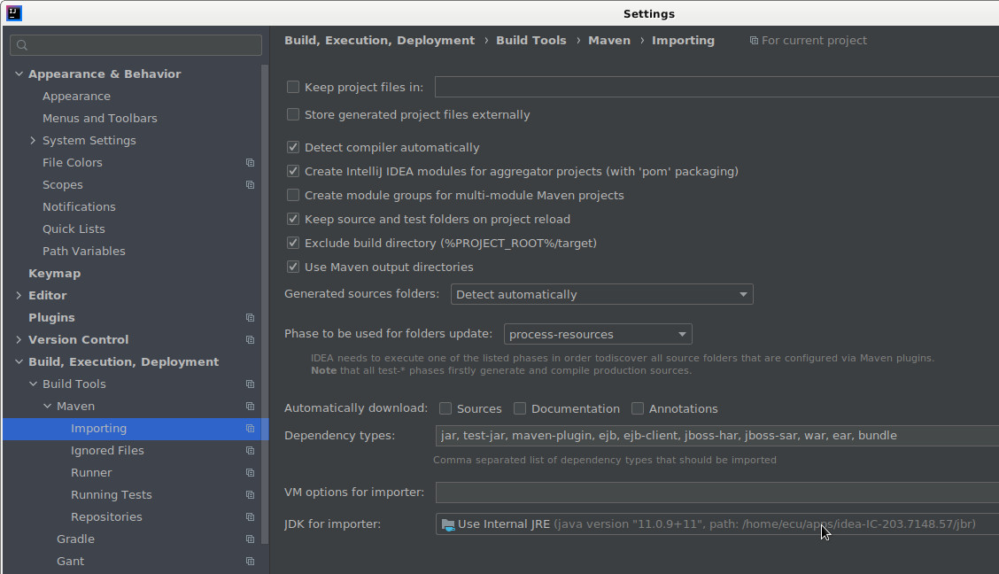
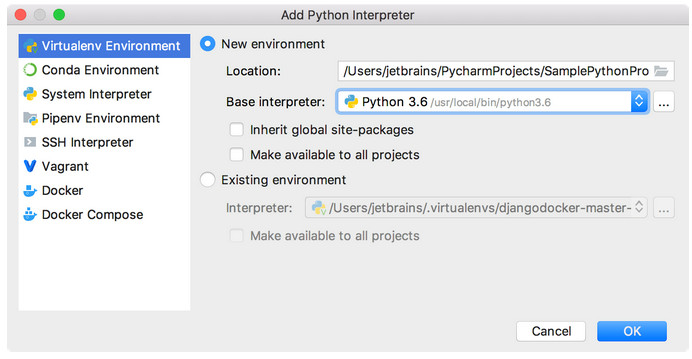

# Jetbrains tools - notes

<a name="index"></a>

| Tool name  | Link                                                                                     | 
|------------|------------------------------------------------------------------------------------------|
| all        | <a href="#merge-branches">Merge 2 branches</a>                                           |
| all        | <a href="#replace-regex">Replace with a regex expression</a>                             |
| IntelliJ   | <a href="#intellij-change-sdk-in-project">Change a project SDK</a>                       |
| IntelliJ   | <a href="#intellij-change-maven-import-jdk">Change Maven import jdk</a>                  |
| IntelliJ   | <a href="#intellij-error-cannot-resolve">Error "cannot resolve" on project classes</a>   |
| IntelliJ   | <a href="#shortcuts">Keyboard shortcuts</a>                                              |
| IntelliJ   | <a href="#env-variable">Use an environment variable</a>                                  |
| Pycharm    | <a href="#pycharm-set-interpreter">Set Python interpreter</a>                            |


## <a name="merge-branches"></a>Merge 2 branches

1) **switch to the target branch** that you want to integrate the changes to
2) **open the branches popup**, and select the branch that you want to merge into the target branch
3) **choose merge into current** from the submenu

4) finish merging with a **push** operation

<a href="https://www.jetbrains.com/help/idea/apply-changes-from-one-branch-to-another.html">source</a><br>
<a href="#index">back to index</a>

## <a name="replace-regex"></a>Replace with a regex expression

Use CTRL + R shortcut to get replace panel. <br/><br/>
Let's replace all dots with a line break :<br/>
<br/>
result : <br/>


<a href="#index">back to index</a>

## <a name="intellij-change-sdk-in-project"></a>IntelliJ - Change a project SDK

- Go to the menu : **File / Project Structure**
- in **Platform Settings**, define a new SDK

- in **Project Settings / Project**, change the **project SDK** and the **project language level**

- in **Project Settings / Modules**, change the **language level** 

<a href="https://mkyong.com/intellij/how-to-change-the-intellij-idea-jdk-version">source</a><br>
<a href="#index">back to index</a>

## <a name="intellij-change-maven-import-jdk"></a>IntelliJ - Change Maven import JDK

By default, IntelliJ uses its own jdk to import projects. <br/>
You can change it, and specify another one: go to menu / settings.


<a href="#index">back to index</a>

## <a name="intellij-error-cannot-resolve"></a>IntelliJ - Error "cannot resolve" on project classes

First clean m2 folder and rebuild project. <br/>
If the problem occurs again, go to menu \ file \ invalidate caches.

<a href="#index">back to index</a>

## <a name="shortcuts"></a>IntelliJ - Keyboard shortcuts

| Shortcut            |  Detail                                                   |
|---------------------|-----------------------------------------------------------|
| double SHIFT        | open a file                                               |
| CTRL + SHIFT + F10  | run current test or all tests if cursor not inside a test |
| CTRL + SHIFT + F    | find in path                                              |
| CTRL + ALT + O      | organise imports                                          |
| CTRL + ALT + B      | see implementations                                       |
| CTRL + R            | replace                                                   |
| CTRL + click        | go to declaration                                         |
| ALT + ENTER         | show action list                                          |

<a href="#index">back to index</a>


## <a name="env-variable"></a>IntelliJ - Use an environment variable

By default, an environment variable won't be available in IntelliJ unless it has been launched with a terminal. <br/>
You can edit your IntelliJ launcher, and put this command : ```/bin/bash -i -c "/path/to/idea/bin/idea.sh" %f``` <br/>
On the next launch, you'll be able to access the variable from your source code. <br/>

Example :
- add the the following variable to ```~/.bashrc``` : ```export FOO=bar```
- reload it : ```source ~/.bashrc```
- confirm it's there : ```echo $FOO```

Now call it : ```System.out.print(System.getenv("FOO"));```


<a href="#index">back to index</a>


## <a name="pycharm-set-interpreter"></a>Pycharm - Setting Python interpreter (Debian 10)

If you face the following error when setting a Python interpreter in Pycharm : <br>
**ModuleNotFoundError: No module named 'distutils.core'** <br><br>
The fix is to install this package : <br>
**sudo apt-get install python3-distutils** <br><br>
Then, use the Python Interpreter widget in the status bar. Click the widget and select 'Add Interpreter'.


<a href="https://www.jetbrains.com/help/pycharm/configuring-python-interpreter.html">source</a><br>
<a href="#index">back to index</a>
