# LaTeX notes

<a name="index"></a>

## Table of contents
1. [ Setup on Debian ](#setup-debian)
   - [ Install Tex Live ](#install-tex-live)
   - [ Install Texmaker ](#install-texmaker)
   - [ Test it ](#test-it)
   - [ Use a library ](#use-library)
2. [ Usage notes ](#usage-notes)
   - [ Basic instructions ](#basic-instructions)
   - [ Colors ](#colors)
   - [ Strike text ](#strike-text)
   - [ Display a picture ](#display-picture)
   - [ TO DO notes ](#todo-notes)
   - [ Tables ](#tables)
   - [ Lists ](#lists)
   - [ Date and time ](#date-time)
   - [ Default symbols ](#default-symbols)
   - [ Pifont symbols ](#pifont-symbols)
   - [ Source code ](#source-code)
   - [ Mathematical expressions ](#math)
   - [ Links ](#links)
   - [ Columns ](#columns)
   - [ Algorithms ](#algorithms)
   - [ Define custom commands ](#custom-commands)
   - [ Dendrogram (tree diagram) ](#dendrogram)
   - [ Set a page in landscape ](#landscape)

## Introduction

LaTeX  is a tool used to create professional-looking documents. It is based on the WYSIWYM (what you see is what you mean) idea, meaning you only have focus on the contents of your document and the computer will take care of the formatting. Instead of spacing out text on a page to control formatting, as with Microsoft Word or LibreOffice Writer, users can enter plain text and let LaTeX take care of the rest. <br><br/>
sources : <br/>
https://www.latex-project.org/ <br/>
https://www.overleaf.com/learn/latex/Learn_LaTeX_in_30_minutes

## <a name="setup-debian"></a>1. Setup on Debian

### <a name="install-tex-live"></a>Install TeX Live

TeX Live is a TeX distribution to get up and running with the TeX document production system. <br/>
Install it with packet manager :
```bash
apt-get install texlive-full
```
source : https://milq.github.io/install-latex-ubuntu-debian/

<a href="#index">back to index</a>

### <a name="install-texmaker"></a>Install Texmaker editor

Texmaker is a free, cross-patform LaTeX editor. <br>
To install it on Debian, download package on official website, then (as root) :<br>
```bash
apt install ./PACKAGE-NAME.deb
```
source : https://www.xm1math.net/texmaker/

<a href="#index">back to index</a>

### <a name="test-it"></a>Test it

Let's try a first minimal document : create a source with .tex extension and the following content :
```latex
\documentclass{article}
\begin{document}
hello world
\end{document}
```
Compile with **menu\tools\Quick Build (F1)**.

<a href="#index">back to index</a>

### <a name="use-library"></a>Use a library

define package usage before the beginning of the document :

```latex
\documentclass{article}
% required package(s)
\usepackage{color}
\begin{document}
% document content
hello world
\end{document}
```

<a href="#index">back to index</a>

## <a name="usage-notes"></a>2. Usage notes

### <a name="basic-instructions"></a>Basic instructions

```latex
%this is a comment
\textbf{this is a bold message} \newline
\underline{this is an underlined message} \newline
\textit{this is a message in italics} \newline

%--- let's add a page break ---
\newpage
```

<a href="#index">back to index</a>

### <a name="colors"></a>Colors

- with color package

```latex
\documentclass{article}
%--- required package ---
\usepackage{color}
\begin{document}
%--- some messages with colors --
\textcolor[RGB]{255,0,0}{text in red} \newline
\textcolor[RGB]{0,255,0}{text in green} \newline
\textcolor[RGB]{0,0,255}{text in blue} \newline
\end{document}
```

- with xcolor package

```latex
\documentclass{article}
%--- required package ---
\usepackage{xcolor}
\begin{document}

% using color codes
\textbf{some messages with color codes :} \newline
\textcolor[RGB]{255,0,0}{text in red} \newline
\textcolor[RGB]{0,255,0}{text in green} \newline
\textcolor[RGB]{0,0,255}{text in blue} \newline\newline

% using colors names
\textbf{some messages with color names :} \newline
\color{black}{black text} \newline
\color{darkgray}{darkgray text} \newline
\color{gray}{gray text} \newline
\color{violet}{violet text} \newline
\color{blue}{blue text} \newline
\color{cyan}{cyan text} \newline
\color{teal}{teal text} \newline
\color{green}{green text} \newline
\color{olive}{olive text} \newline
\color{lime}{lime text} \newline
\color{yellow}{yellow text} \newline
\color{orange}{orange text} \newline
\color{red}{red text} \newline
\color{magenta}{magenta text} \newline
\color{pink}{pink text} \newline
\color{purple}{purple text} \newline
\end{document}
```

result : <br/>
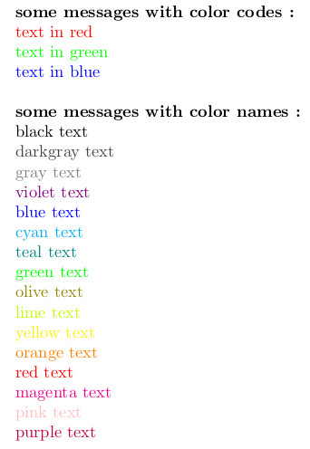

link : https://en.wikibooks.org/wiki/LaTeX/Colors

<a href="#index">back to index</a>


### <a name="strike-text"></a>Strike text

```latex
\documentclass{article}
%--- required package ---
%--- strike text using \sout{text to strike} ---
\usepackage{ulem}
\begin{document}
\sout{this text is striked out}
\end{document}
```

<a href="#index">back to index</a>


### <a name="display-picture"></a>Display a picture as a figure

```latex
\documentclass{article}
%--- required package ---
\usepackage{graphicx}
\begin{document}
%--- picture set as a figure ---
\begin{figure}[!h]
\begin{center}
\includegraphics[scale=0.5]{img/dark-side.jpg}
\caption{this is the text below image}
\label{pictureOfCats}
\end{center}
\end{figure}
\end{document}
```

then add a reference to the figure in the text :
```latex
see Figure \ref{pictureOfCats}
```

<a href="#index">back to index</a>

### <a name="todo-notes"></a>TO DO notes

```latex
\documentclass{article}
%--- define package or uncomment option to disable todo notes ---
\usepackage{todonotes}
%\usepackage[disable]{todonotes}
%--- inline by default ---
\presetkeys{todonotes}{inline}{}
\begin{document}
%--- some examples ---
\todo[inline]{here's a default todo note in orange}
\todo[inline,backgroundcolor=green]{this second one is using green instead of default color}
\todo[backgroundcolor=yellow]{this one is inline by default}
%--- show a list of all to do notes ---
\listoftodos
\end{document}
```

<a href="#index">back to index</a>

### <a name="tables"></a>Tables

- **example 1**
```latex
\documentclass{article}
\usepackage{colortbl}
\usepackage{float}
\begin{document}

\definecolor{tableH}{RGB}{142,162,198} % blue
\definecolor{colAttr}{RGB}{213,229,255}

\begin{tabular}{l l l l}
  \hline 
\rowcolor{tableH} & \textbf{Field name} & \textbf{Type} & \textbf{Description} \\ \hline
	\tiny{PK} & \underline{ID\_USR} & integer & id of record \\ \hline  
	& USR\_FIRSTNAME & varchar(60) & first name of user \\ \hline
	& USR\_LASTNAME & varchar(60) & last name of user \\ \hline
\end{tabular}

\end{document}
```

result : <br/>
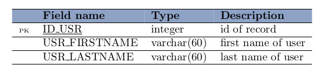


- **example 2**
```latex
\documentclass{article}
\usepackage{colortbl}
\usepackage{float}
\begin{document}

\definecolor{tableH}{RGB}{142,162,198} % blue
\definecolor{colAttr}{RGB}{213,229,255}

 \begin{tabular}{| c | l |}
   \hline
   1 & line 1 \\ \hline 
   2 & line 2 \\ \hline
   3 & line 3 \\ \hline
 \end{tabular}

\end{document}
```

result : <br/>
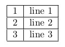


- **example 3**
```latex
\documentclass{article}
\usepackage{colortbl}
\usepackage{float}
\begin{document}

\definecolor{tableH}{RGB}{142,162,198} % blue
\definecolor{colAttr}{RGB}{213,229,255}

\begin{figure}[H]
\begin{center}
 \begin{tabular}{| l | l | l |}
   \hline
   \cellcolor{tableH}{} & \cellcolor{tableH}{\textbf{H title 1}} & \cellcolor{tableH}{\textbf{H title 2}} 	\\ \hline
   \cellcolor{colAttr}{V title 1} & \cellcolor{green}{cell 22} & \cellcolor{green}{cell 23} \\ \hline
   \cellcolor{colAttr}{V title 2} & \cellcolor{yellow}{cell 32} & \cellcolor{yellow}{cell 33} 	\\ \hline
 \end{tabular}
\caption{some caption for my table}
\label{TableOfSomething}
\end{center}
\end{figure}

\end{document}
```

result : <br/>
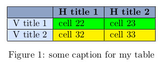

<a href="#index">back to index</a>


### <a name="lists"></a>Lists

```latex
\documentclass{article}
% lists (+ remove blank spaces)
\usepackage{enumitem}
\setlist[itemize]{noitemsep, topsep=0pt}
\setlist[enumerate]{noitemsep, topsep=0pt}
\begin{document}

% an unordered list with default label (a bullet)
\begin{itemize}
\item line A
\item line B
\item line C
\end{itemize} 
$\newline$

% an unordered list with a dash for each item 
\begin{itemize}[label={--}]
\item line D 
\item line E
\item line F 
\end{itemize} 
$\newline$

% an unordered list with a star for each item 
\begin{itemize}[label=$\ast$]
\item line G 
\item line H
\item line I 
\end{itemize} 
$\newline$

% an ordered list with 1. 2. ... 
\begin{enumerate}
\item line J
\item line K
\item line L
\end{enumerate}
$\newline$

% an ordered list with 1) 2) etc
\begin{enumerate}[label=\arabic*)]
\item line M
\item line N
\item line O
\end{enumerate}
$\newline$

% an ordered list with a) b) etc
\begin{enumerate}[label=\alph*)]
\item line P
\item line Q
\item line R
\end{enumerate}
$\newline$

\end{document}
```

<a href="#index">back to index</a>


### <a name="date-time"></a>Date and time

```latex
\documentclass{article}
%---------------- packages --------------------------
%\usepackage{datetime2}
\usepackage[datesep=/,style=ddmmyyyy]{datetime2}
\begin{document}
% default : 2020-05-29
% with current style : 29/05/2020
current day : \today  \newline

% 15:36:10
current time : \DTMcurrenttime \newline
\end{document}
```

link : https://ctan.org/pkg/datetime2

<a href="#index">back to index</a>


### <a name="default-symbols"></a>Default symbols

```latex
\documentclass{article}
% no additional package required
\begin{document}
symbols for list : $\bullet$ $\ast$ $\star$ $\diamond$ $\circ$ \newline
3 dots : \ldots \newline
not equals : $\neq$ \newline
greather or equal : $\geq$ \newline
lower or equal : $\leq$ \newline
logical and : $\land$ \newline
logical not : $\lnot$ \newline
simple right arrow : $\rightarrow$ \newline
double right arrow : $\Rightarrow$ \newline
simple left right arrow : $\leftrightarrow$ \newline
double left right arrow : $\Leftrightarrow$ \newline
infinite symbol : $\infty$ \newline
math symbols : $\times$ $\div$ \newline
other usefull symbols : $\triangle$ $\clubsuit$ $\heartsuit$ $\diamondsuit$ $\spadesuit$ \newline
\end{document}
```

result : <br/>
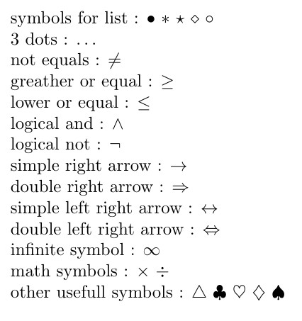

<a href="#index">back to index</a>


### <a name="pifont-symbols"></a>Pifont symbols

- **table of existing pifont symbols**
  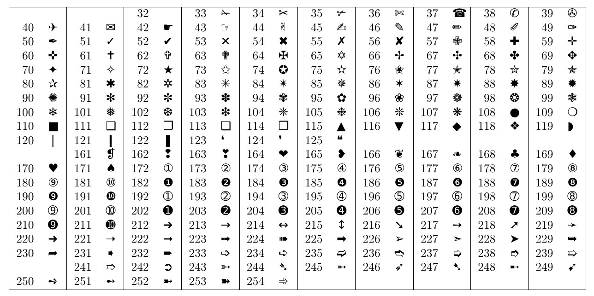

- **example**

```latex
\documentclass{article}
\usepackage{color}
%-- pifont symbols : use \ding{symbol-number} --
\usepackage{pifont}
\begin{document}
%---- macros ---
\newcommand{\true}{\textcolor[RGB]{0,128,0}{\ding{51}}}
\newcommand{\false}{\textcolor[RGB]{255,0,0}{\ding{55}}}

using V symbol with standard instruction : \ding{51} \newline
using V symbol with macro : \true \newline
using X symbol with macro : \false \newline
square symbol : \ding{110} \newline
phone symbol : \ding{37} \newline

\end{document}
```

result : <br/>
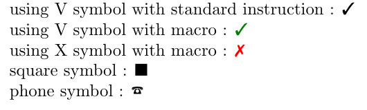

<a href="#index">back to index</a>


### <a name="source-code"></a>Source code

- **java source code**
```latex
\documentclass{article}
%--- requires 2 packages and a custom setting for java source code ---
\usepackage{color}
\usepackage{listings}
\include{settings/java_source_code_settings}
\begin{document}
%--- list a partial or complete java class with colored syntax --- 
\lstinputlisting[language=Java, firstline=1, lastline=10]{java/Person.java} 
\lstinputlisting[language=Java]{java/Person.java}
%--- you can also put the code directly in the document ---
\begin{lstlisting}[language=Java]
    here some java code
\end{lstlisting}
\end{document}
```

- **some sql**
```latex
\begin{lstlisting}[language=SQL,
					showspaces=false,
					basicstyle=\ttfamily,
					numbers=left,
					numberstyle=\tiny,
					commentstyle=\color{gray},
					frame=single]
select * from USERS;
\end{lstlisting}
```

<a href="#index">back to index</a>

### <a name="math"></a>Mathematical expressions

- **triangle inequality**
```latex
triangle inequality: \newline
$AB \leq AC + CB$ \newline
$AC \leq AB + BC$ \newline
$BC \leq BA + AC$ \newline
```

result : <br/>


- **euclidian distance**
```latex
euclidian distance : \newline
$\sqrt{(x_B - x_A)^2 + (y_B - y_A)^2}$
```

result : <br/>
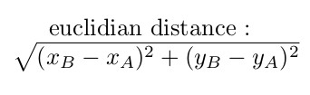

<a href="#index">back to index</a>


### <a name="links"></a>Links

```latex
\documentclass{article}
\usepackage{hyperref}
\include{settings/hyperlink_settings}
\begin{document}
a basic link : \url{www.python.org} \newline
a link with text displayed : \href{www.python.org}{this is the official website of Python} \newline
link to email someone : \href{mailto:bob.razovsky@mail.com}{bob email address}
\end{document}
```

<a href="#index">back to index</a>

### <a name="columns"></a>Columns

```latex
\documentclass{article}
\begin{document}
% display 2 pictures beside each other, with same size
\begin{minipage}[t]{0.5\textwidth}
\includegraphics[scale=1.4]{img/picture1.jpg}
\end{minipage}
\begin{minipage}[t]{0.5\textwidth}
\includegraphics[scale=1.4]{img/picture2.jpg}
\end{minipage}
\end{document}
```

<a href="#index">back to index</a>


### <a name="algorithms"></a>Algorithms in pseudo-code

- required packages
```latex
\usepackage{algorithm}
\usepackage{algorithmic}
```

- **example : insertion sort**
```latex
\begin{algorithm}
\caption{Insertion sort algorithm} 
\begin{algorithmic}[1]
%\STATE \textbf{InsertionSort(int[ ] array, int length)} 
\REQUIRE int $array[]$ : an array of integers from index $0$ to $length - 1$
\STATE int $i = 1$, $j = NULL$, $tmp = NULL$
\WHILE{($i < length$)}
	\STATE $j = i$
	\STATE $tmp = array[i]$
	\WHILE{($j >= 1$ \AND $tmp < array[j - 1]$)}
		\STATE $array[j] = array[j - 1]$
		\STATE $j = j - 1$
	\ENDWHILE
	\STATE $array[j] = tmp$
	\STATE $i = i + 1$
\ENDWHILE
\RETURN a sorted array
\end{algorithmic}
\end{algorithm} 
```

result : <br/>
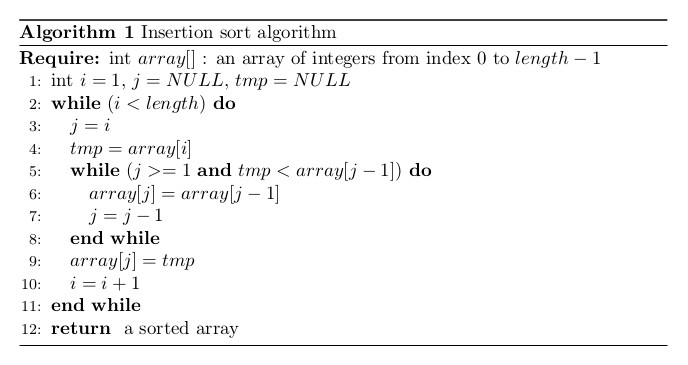


- **example : binary search**
```latex
\begin{algorithm}
\caption{Binary search algorithm} 
\begin{algorithmic}[1]
\STATE \textbf{BinarySearch(int[ ] array, int begin, int end, int searched)} 
\IF{(end $<$ begin)}
	\RETURN -1 
\ELSE
	\STATE int middle = begin + ((end - begin + 1) / 2)		
	\IF{array[middle] = searched}
		\RETURN middle
	\ELSIF{array[middle] $<$ searched}	
		\RETURN \textbf{BinarySearch(array, middle + 1, end, searched)}
	\ELSE
		\RETURN \textbf{BinarySearch(array, begin, middle - 1, end, searched)}
	\ENDIF
\ENDIF
\end{algorithmic}
\end{algorithm} 
```

result : <br/>
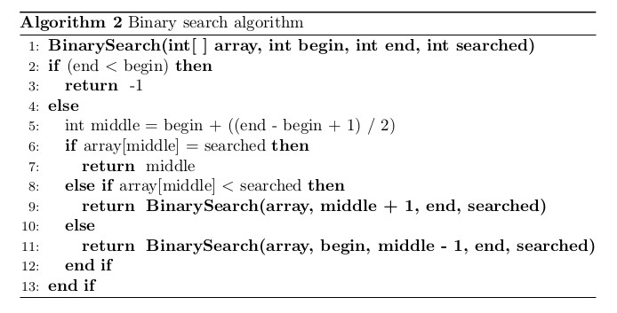

<a href="#index">back to index</a>

### <a name="custom-commands"></a>Define custom commands

```latex
\documentclass{article}
\begin{document}
% call a block of text/code from one custom command
\newcommand{\hello}{hello world}
% draw a line
\newcommand{\drawline}{$\newline$\noindent\makebox[\linewidth]{\rule{\textwidth}{1pt}}$\newline$}
% add an horizontal blank space
\newcommand\tab[1][1cm]{\hspace*{#1}}
% try it
\drawline
\tab \hello 
foo\tab bar\tab[2cm]baz
\drawline
\end{document}
```

<a href="#index">back to index</a>

### <a name="dendrogram"></a>Dendrogram (tree diagram)

```latex
\documentclass{article}
\usepackage{tikz-qtree}
\begin{document}
\begin{figure}[!h]
	\center
	\begin{tikzpicture}
\tikzset{edge from parent/.style={draw, 
	edge from parent path={(\tikzparentnode.south) -- +(0,-8pt) -| (\tikzchildnode)}}} 
\Tree [.A [.B [.D H ] [.E I ] ]
	[.C [.F J ]
		[.G [.K ] [.L ] ] ] ]
	\end{tikzpicture}
    \caption{Example of dendrogram}
\end{figure}
\end{document}
```

result : <br/>
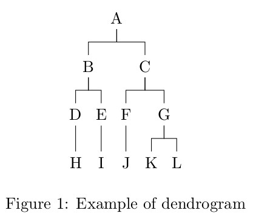

<a href="#index">back to index</a>

### <a name="landscape"></a>Set a page in landscape

```latex
\documentclass{article}
\usepackage{lscape}
\begin{document}
% page 1
some text at page 1
\newpage

% page 2 in landscape
\begin{landscape}
some text in landscape
\end{landscape}
\newpage

% page 3
some text at page 3
\end{document}
```

<a href="#index">back to index</a>
